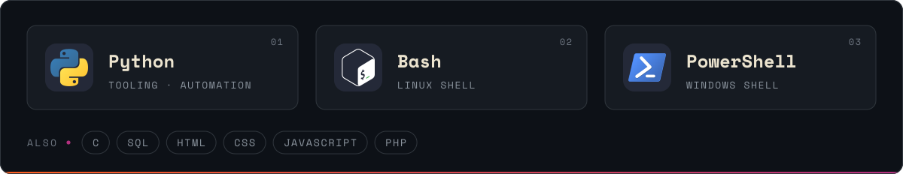

  

$ whoami

Cybersecurity & Digital Forensics student, focused on penetration testing.
I'd rather understand what a tool does underneath than just run it.

$ cat now.txt
building: a security scanner for agentic AI skills and plugins
lab: Kali, Windows and Metasploitable 3 VMs
practice: TryHackMe, FlagYard CTFs, Overthewire
$ ls ~/toolbox

$ ./decrypt_me
text
TZUIT EYMXZ ZUSXZ GIGJS

 
machine settings
  

Enigma I · reflector UKW-B · rotors I II III · rings A A A · start S Y N · no plugboard

